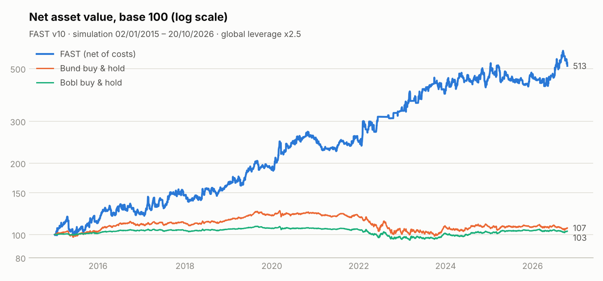
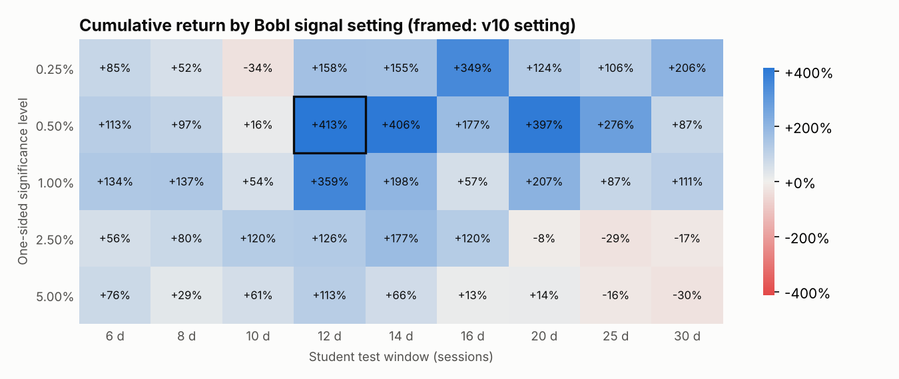

# FAST — Futures-based Algorithmic Strategy and Trading

[](https://github.com/EthanMAL20/fast-bund-bobl/actions/workflows/ci.yml)


A systematic directional strategy on **Eurex German government bond futures**, Bund (10y, FGBL)
and Bobl (5y, FGBM), with a full backtesting engine and a risk report: historical VaR,
Kupiec backtest, UCITS VaR limit check and parameter-sensitivity analysis.

The strategy was first built as an Excel model. This repository is a Python port of it that
**gives the same daily NAV as the spreadsheet, to the cent, over 3,007 sessions**, on the
production settings and on three other configurations that together cover every signal method
and every option.



## Results

### Version 11 (Bund only) — walk-forward validation, 2018 → 2026, net of costs

Each year, the parameters (RSI period, volatility-filter cap) are chosen on the 3 previous years
only, then frozen and traded for the year. Full table in [docs/walk_forward.md](docs/walk_forward.md).

| Metric | Out-of-sample (walk-forward) | Fixed v11 settings |
|---|---:|---:|
| Annualised return | 5.9 % | 5.2 % |
| Annualised volatility | 7.1 % | 7.9 % |
| Sharpe ratio (over the ECB deposit rate) | **0.68** | 0.53 |
| Maximum drawdown | −15.0 % | −14.4 % |
| Days with 20-day VaR > 20 % (UCITS limit), 2015–2026 | — | 41 (vs 607 for v10) |

The edge is concentrated in stress periods: excluding 2020, the out-of-sample Sharpe ratio is 0.24.
The parameter grid is centred on settings already known to work, so the test is somewhat optimistic.

### Why v10 was abandoned

Version 10 showed +413 % (14.9 % per year, Sharpe 0.73) in-sample. Performance attribution showed
that the Bobl leg — 3.48 M€ of the 4.55 M€ gross P&L — earned the same as a naive rule
"long Bobl until 7 January 2022, short afterwards" at constant leverage (148 % vs 147 %, sum of
daily returns). Its result came from the ECB rate-regime change, not from the signal, so the Bobl
leg is switched off in v11 (`config/v11.yaml`). The v10 analysis is kept below for reference.

<details>
<summary>Version 10 results (in-sample, 2 Jan 2015 → 20 Oct 2026)</summary>

| Metric | Value |
|---|---|
| Cumulative / annualised return | +413 % / 14.9 % per year |
| Annualised volatility | 19.3 % |
| Sharpe ratio (over the ECB deposit rate) | 0.73 |
| Maximum drawdown | −20.3 % (25 Nov 2025) |
| Gross exposure, average / max | 7.0x / 12.0x NAV |
| P&L contribution, Bund / Bobl | 1.07 M€ / 3.48 M€ (for 1 M€ initial NAV) |
| Historical VaR 99 % 1-day, last position | 3.4 % of NAV (173 k€) |
| VaR backtest | 38 exceptions over 2,400 invested sessions (1.6 % vs 1 %), Kupiec p = 0.008 |

**These are in-sample results.** The parameters were chosen on the same history. See
[Robustness and limitations](#robustness-and-limitations) before reading anything into them.

| Year | Return | Vol | Max DD | VaR 99 % avg | VaR 99 % max | Days with 20-day VaR > 20 % | Avg exposure |
|---|---:|---:|---:|---:|---:|---:|---:|
| 2015 | +11.9 % | 18.8 % | −15.9 % | 2.4 % | 7.5 % | 12 | 7.6x |
| 2016 | +10.6 % | 16.2 % | −10.6 % | 3.3 % | 7.6 % | 67 | 8.1x |
| 2017 | +18.1 % | 18.9 % | −12.4 % | 3.3 % | 6.0 % | 89 | 8.5x |
| 2018 | +11.2 % | 13.1 % | −7.5 % | 2.4 % | 5.9 % | 14 | 8.0x |
| 2019 | +15.0 % | 15.1 % | −8.6 % | 2.2 % | 4.0 % | 0 | 8.6x |
| 2020 | +36.0 % | 20.3 % | −12.0 % | 3.5 % | 7.0 % | 56 | 8.5x |
| 2021 | −3.6 % | 12.6 % | −12.5 % | 2.0 % | 7.0 % | 14 | 8.3x |
| 2022 | +40.2 % | 21.7 % | −10.6 % | 1.5 % | 8.5 % | 52 | 2.7x |
| 2023 | +17.2 % | 23.4 % | −14.5 % | 3.8 % | 16.1 % | 108 | 3.3x |
| 2024 | +13.3 % | 22.5 % | −17.0 % | 3.8 % | 15.6 % | 121 | 6.0x |
| 2025 | +1.4 % | 21.0 % | −20.3 % | 2.9 % | 8.3 % | 30 | 7.5x |
| 2026 YTD | +10.8 % | 25.0 % | −13.7 % | 2.6 % | 5.7 % | 46 | 7.2x |

</details>

## Strategy

Each day, at the Eurex settlement (17:15 Paris), the model takes a long, short or flat position
on each contract. The size is a multiple of NAV that depends on the strength of the signal.

**Bund leg (half weight)**
- Main signal: 14-day Wilder RSI, trend rule (RSI > 50 → long, < 50 → short). Student t-test,
  triple moving average and MACD are available as alternatives.
- Confirmation 1: Hang Seng triple moving average (3/30/120 days). Hong Kong closes before the
  Eurex settlement, so there is no look-ahead.
- Confirmation 2: US Non-Farm Payrolls, read from the Bund's own move on the release day
  (14:30 Paris, before the settlement) and kept until the next release. The Dow Jones, with
  yesterday's close, is an alternative.
- Leverage table: Long 3x, Mid-Long 2x, Mid-Short −1x, Short −3x, NOK 0.

**Bobl leg**
- Main signal: one-sided Student t-test on the last 12 daily price changes,
  t = √N · mean / std, at the 0.5 % level, keeping the previous signal while |t| stays below
  the threshold. Optional robustness mode: average leverage over 10 windows (5 to 30 days).
- Optional confirmation: t-test on the EUR 2y–5y swap slope, or NFP.
- Leverage table: Long 3x, Short −3x.

**Risk management and execution**
- Volatility filter: flat when the annualised volatility of the previous N sessions is outside
  a band (Bund ≤ 5 % over 13 days, Bobl ≤ 4 % over 5 days). A volatility-targeting sizing method
  is also available.
- Circuit breaker: flat after 3 (Bund) or 4 (Bobl) consecutive losing sessions.
- Global leverage multiplier ×2.5. Contracts = NAV × leverage × weight × signal ÷ notional,
  rounded to whole contracts.
- Roll on the Eurex last trading day: the position is closed at the settlement and reopened on
  the next contract the next session, so the jump in the generic series is never booked as P&L.
- Costs: 2 € brokerage plus 0.5 tick of slippage per contract per side (rolls included),
  0.5 %/yr management fee, optional performance fee with a high-water mark. Cash earns the ECB
  deposit rate (ACT/360, negative rates applied).

## Validation against the Excel model

`tests/test_excel_parity.py` runs the engine on the original data. It checks:

| Configuration | What it exercises | Final NAV (Excel = Python) |
|---|---|---:|
| v10 (production) | RSI, Hang Seng, NFP, Student 12 days | 5,126,272.34 € |
| Variant A | Student multi-window on both legs, Dow Jones, roll jump excluded from volatility, weekly Bobl rebalancing | 1,265,345.52 € |
| Variant B | Moving averages, MACD sign rule, volatility targeting, weekly Bund rebalancing, 20 % performance fee, 0 % rate floor, cash margin | 304,553.95 € |
| Variant C | MACD crossover, RSI mean reversion with persistence, 2y–5y slope confirmation, NFP held 5 sessions | 1,401,663.88 € |

The match is exact on every session: contracts, leverage and NAV. The variants were obtained by
changing the parameter sheet and recalculating the workbook. The risk module also reproduces
the figures of the original PDF risk report: VaR by year, UCITS breach days, 38 exceptions and
the 3.4 % / 173 k€ VaR of the last position.

## Robustness and limitations



- **Parameter fragility.** Over a 45-point grid of Bobl settings (window × significance level),
  the production setting (12 days, 0.5 %) is the best of the 45. The median is +106 % and
  6 settings lose money. Moving from 12 to 10 days gives +16 % instead of +413 %. The headline
  result depends on one specific setting.
- **One regime change carries the Bobl leg.** With the 12-day test, the Bobl signal changes
  direction only once in the whole sample: long from January 2014, short from 7 January 2022,
  when ECB rate hikes started. The Bobl leg makes 3.48 M€ of the 4.55 M€ gross P&L, and
  2.76 M€ of that comes after the switch.
- **Risk has risen since 2022.** The leverage table is set in multiples of NAV and ignores
  market volatility. Bobl volatility went from about 2 % per year before 2021 to 3–6 % since.
  The 20-day VaR (1-day VaR × √20) would have breached the 20 % UCITS limit on up to 121
  sessions a year, so the strategy could not be run inside a UCITS fund at this leverage.
- **VaR underestimates risk.** Exceptions run at 1.6 % instead of 1 %, and the Kupiec test
  rejects correct coverage (p = 0.008), mostly through sudden shocks after calm periods.
- **Simplifications.** Execution is assumed at the settlement price that is also used to
  compute the signal (a slightly favourable bias). Generic series are not back-adjusted.
  Initial and variation margin are not modelled.

## Quickstart

```bash
git clone https://github.com/EthanMAL20/fast-bund-bobl.git
cd fast-bund-bobl
python -m venv .venv && source .venv/bin/activate      # Windows: .venv\Scripts\activate
pip install -e ".[dev]"

python scripts/make_sample_data.py                     # synthetic data -> data/sample
fastbb run --data data/sample --config config/v10.yaml --out reports/sample
pytest -q
```

The synthetic data set has random walks with realistic volatility, so the pipeline runs
anywhere. Its backtest numbers mean nothing.

**With the real data** (Bloomberg: `RX1 Comdty` / `OE1 Comdty` PX_SETTLE, `HSI Index`,
`INDU Index`, `EUSA2` / `EUSA5 Curncy`; BLS payrolls; ECB deposit rate):

```bash
fastbb import-excel Modele_FAST_Bund_Bobl_v10.xlsx --out data/raw   # data/raw is git-ignored
fastbb run --data data/raw --config config/v10.yaml --out reports/v10
python scripts/sensitivity.py --data data/raw --out docs
python scripts/walk_forward.py --data data/raw --config config/v11.yaml --out docs
```

Licensed market data is not distributed with this repository.

**Python API**

```python
from fastbb import Config, MarketData, run_backtest
from fastbb.risk import summary, historical_var, kupiec_pof

md = MarketData.from_csv("data/raw")
cfg = Config.from_yaml("config/v10.yaml")
cfg.bobl.signal.multi_windows = True          # every Excel parameter is a typed attribute
res = run_backtest(md, cfg)

print(summary(res)["sharpe"])
var = historical_var(res, confidence=0.99, lookback=250)
print(kupiec_pof(int(var.invested.sum()), int(var.exceptions.sum())))
```

## Project structure

```
config/v10.yaml, v11.yaml  strategy parameters (one file per version)
src/fastbb/
  config.py              typed dataclasses, YAML loading with validation
  data.py                CSV / Excel loaders, data checks
  calendar.py            Eurex quarterly roll calendar
  indicators.py          rolling t-stat, moving averages, MACD, Wilder RSI, realised volatility
  signals.py             Bund and Bobl signal pipelines (confirmations, filter, leverage table)
  backtest.py            daily portfolio engine (sizing, roll, costs, cash, fees)
  risk.py                performance stats, historical VaR, Kupiec test, yearly table
  report.py              charts and Markdown report
  walkforward.py         walk-forward validation
  cli.py                 `fastbb` command
scripts/                 synthetic data generator, parameter sensitivity
tests/                   unit tests, accounting identities, Excel parity
```

## Roadmap

- Same signal on other rates futures (Schatz, Buxl, OAT, BTP, T-Note) with frozen parameters
- Volatility-scaled leverage table, so that risk stays constant across regimes
- Expected Shortfall and stressed VaR (2022 rate shock, March 2023 banking stress)
- Execution at the next session's open, and back-adjusted continuous contracts
- Vectorised / Numba engine for large parameter sweeps

## Disclaimer

Research project. Simulated past performance does not predict future returns. Nothing here is
investment advice.
